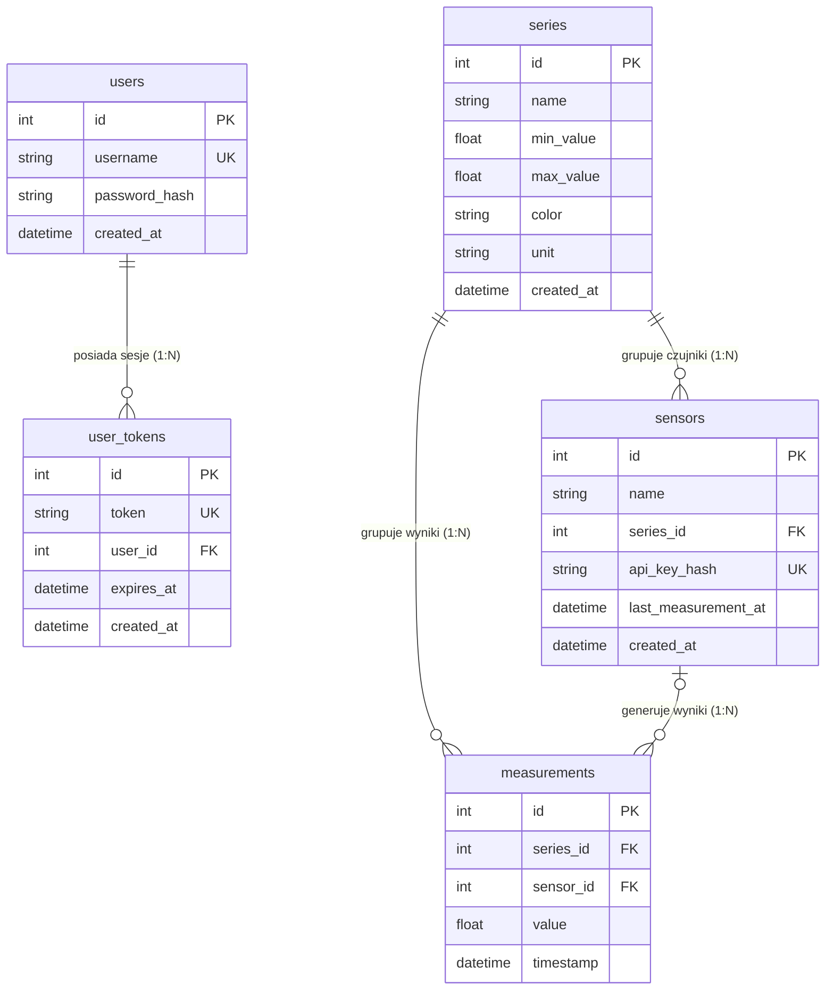

# 🏰 Waterdeep Watchtower – Dokumentacja Projektu (ZAI 26Z)

**Projekt:** System zbierania i wizualizacji telemetrii miejskiej IoT  
**Przedmiot:** Zaawansowane Aplikacje Internetowe (ZAI 26Z)  
**Autor:** Student Politechniki  
**Termin:** Etap E2 (Aplikacja końcowa)  

---

## 1. Adres Wdrożonej Aplikacji i Repozytorium

* **Adres aplikacji w chmurze (HTTPS):** `https://twoja-aplikacja.example.com` *(podaj swój publiczny adres URL)*
* **Adres API w chmurze:** `https://twoja-aplikacja.example.com/api`
* **Dokumentacja Swagger UI:** `https://twoja-aplikacja.example.com/docs`
* **Repozytorium Git (GitHub):** `https://github.com/twoj-login/waterdeep-watchtower` *(podaj link do repozytorium)*
* **Status automatycznych testów CI (GitHub Actions):** Dostępny w zakładce *Actions* w repozytorium (wszystkie zadania zielone: testy Pytest, kompilacja frontendu i weryfikacja kontraktu).

---

## 2. Dane Logowania Konta Administratora

Zgodnie z wymaganiami specyfikacji, w systemie przygotowano działające testowe konto administratora:

* **Nazwa użytkownika:** `admin`
* **Hasło:** `HasloAdministratora123!`
* **Uprawnienia konta:** Zarządzanie konfiguracją systemu: dodawanie, modyfikacja i usuwanie serii pomiarowych (F8), rejestracja nowych czujników i pobieranie ich jednorazowych kluczy API (F12), wyrejestrowywanie czujników oraz zmiana hasła administratora (F8).
* **Ochrona ról (F3):** Czytelnik (niezalogowany) posiada dostęp wyłącznie do odczytu danych telemetrycznych. Wyników pomiarów nie może dodawać, modyfikować ani usuwać żaden użytkownik z poziomu interfejsu graficznego.

---

## 3. Instrukcja Lokalnego Uruchomienia i Generatora Danych

### 3.1. Wymagania Środowiskowe
* **System operacyjny:** Linux, macOS lub Windows (WSL2)
* **Python:** wersja 3.11 lub 3.12
* **Node.js:** wersja 20+ (z menedżerem pakietów `npm`)

### 3.2. Szybkie Uruchomienie Aplikacji (`./run.sh`)
Repozytorium wyposażone jest w inteligentny skrypt uruchomieniowy `run.sh`:

```bash
# 1. Główny start (kompletna aplikacja SPA + API na porcie 8000):
./run.sh

# 2. Tryb pracy na żywo (aplikacja + działający w tle emulator wysyłający pomiary co 30s):
./run.sh --live

# 3. Tryb bezpieczny HTTPS (port 8443 pod testy bezpieczeństwa E2 z lokalnym SSL):
./run.sh --https

# 4. Tryb deweloperski (backend FastAPI 8000 + frontend Vite 5173 z hot-reloadem):
./run.sh --dev
```

*Skrypt automatycznie sprawdza stan bazy danych: jeśli baza jest pusta, przed uruchomieniem serwera zasila ją 6 seriami i 120 pomiarami przykładowymi przez API (wymóg F11/T11).*

### 3.3. Generator Danych Telemetrycznych (Emulator Czujnika F13 / T11)
Generator dostarczany jest w pliku `generator/cli.py` i komunikuje się z serwerem wyłącznie przez HTTP `POST /api/measurements` z nagłówkiem `X-API-Key`:

```bash
python3 generator/cli.py --api http://localhost:8000 --key <KLUCZ_API> [PARAMETRY]
```

**Dostępne parametry:**
* `--api <URL>` – adres bazowy interfejsu API (domyślnie `http://127.0.0.1:8000`).
* `--key <KLUCZ>` – klucz API czujnika (nagłówek `X-API-Key`).
* `--mode <TRYB>` – profil generowania wartości:
  * `sine` – fala sinusoidalna (płynny przebieg harmoniczny),
  * `random` – wartości pseudolosowe z rozkładu jednostajnego,
  * `linear` – liniowy trend narastający,
  * `constant` – stała wartość,
  * `out-of-range` – celowe przekroczenie dopuszczalnego zakresu serii (demonstracja walidacji F4).
* `--min-value <FLOAT>` / `--max-value <FLOAT>` – zakres generowanych liczb.
* `--interval <SEKUNDY>` – odstęp czasu między kolejnymi pomiarami w trybie na żywo (domyślnie 30.0 s).
* `--count <LICZBA>` – liczba próbek do wygenerowania (wartość `0` oznacza pętlę nieskończoną).
* `--history` – generowanie pomiarów ze znacznikami czasu z przeszłości (dla danych demonstracyjnych).
* `--step-minutes <FLOAT>` – odstęp czasowy w minutach dla próbek historycznych (domyślnie 15 min).

---

## 4. Diagram ERD i Struktura Bazy Danych (T4, B4)

System wykorzystuje relacyjną bazę danych (SQLite lokalnie / PostgreSQL na serwerze produkcyjnym) ze zdefiniowanym schematem SQL (`docs/schema.sql`).



### Opis Tabel i Relacji:
1. **`users`** – konta administratorów z bezpiecznym skrótem hasła Argon2id.
2. **`user_tokens`** – aktywne tokeny sesyjne powiązane relacją `ON DELETE CASCADE` z kontem użytkownika. Wylogowanie trwale usuwa token.
3. **`series`** – serie pomiarowe z ograniczeniem `CHECK (min_value < max_value)`. Usunięcie serii kaskadowo usuwa powiązane czujniki i pomiary.
4. **`sensors`** – zarejestrowane czujniki IoT przypisane do serii. Klucz API przechowywany jest wyłącznie jako skrót kryptograficzny SHA-256 (64 hex).
5. **`measurements`** – niemodyfikowalne odczyty telemetryczne. Usunięcie czujnika zachowuje pomiary w bazie (`sensor_id` ustawiane na `NULL`).
6. **Indeksy wydajnościowe:** Indeks kompozytowy `ix_measurements_series_timestamp ON measurements(series_id, timestamp)` gwarantuje natychmiastowe wyszukiwanie w zapytaniach zakresowych.

---

## 5. Elementy Bezpieczeństwa (T5, B3)

W aplikacji zaimplementowano zaawansowane mechanizmy bezpieczeństwa zgodnie z wymaganiem T5:

### 5.1. Bezpieczne Przechowywanie Haseł: Algorytm Argon2id
* **Gdzie w kodzie:** Moduł `backend/app/security.py` (funkcje `hash_password`, `verify_password`, `verify_dummy_password`) oraz router logowania `backend/app/routers/auth.py`.
* **Przed czym chroni:** Chroni przed atakami słownikowymi i siłowymi (brute-force) przy użyciu wyspecjalizowanych klastrów GPU i układów ASIC w przypadku wycieku bazy danych. Argon2id (zwycięzca Password Hashing Competition) łączy odporność na ataki w pamięci (memory-hard) i ataki czasowe (side-channel).
* **Ochrona przed wyliczaniem użytkowników (User Enumeration):** W przypadku podania nieistniejącego loginu system wykonuje weryfikację hasła pozornego (`verify_dummy_password`), eliminując różnice w czasie odpowiedzi serwera (timing attack).

### 5.2. Ochrona Kluczy API Czujników: Haszowanie SHA-256
* **Gdzie w kodzie:** Moduł `backend/app/security.py` (funkcje `generate_sensor_api_key`, `hash_api_key`), `backend/app/routers/sensors.py` oraz `backend/app/routers/measurements.py`.
* **Przed czym chroni:** Chroni przed przejęciem tożsamości sensorów i fałszowaniem telemetrii miejskiej w razie nieautoryzowanego odczytu bazy danych.
* **Zasada działania:** Podczas rejestracji nowego sensora aplikacja generuje kryptograficznie bezpieczny klucz o długości ponad 43 znaków (`secrets.token_urlsafe(32)`). Klucz jest wyświetlany administratorowi **dokładnie jeden raz**. W bazie danych zapisywany jest wyłącznie skrót **SHA-256**. Podczas przesyłania pomiarów serwer haszuje otrzymany nagłówek `X-API-Key` i porównuje skrót w bazie.

---

## 6. Rozszerzenia Kontraktu API

1. **Transmisja na Żywo przez WebSocket (`/ws/telemetry` – Punkty Dodatkowe):**  
   Zaimplementowano dwukierunkowy kanał WebSocket. Przy każdym poprawnym zapisie pomiaru przez czujnik (`POST /api/measurements`), serwer asynchronicznie rozsyła payload pomiaru do połączonych klientów. Wykres i tabela w przeglądarce aktualizują się natychmiast bez konieczności odpytywania serwera.
2. **Globalny Nagłówek Content-Security-Policy (CSP):**  
   Wdrożono restrykcyjne reguły CSP (`default-src 'self'; connect-src 'self' ws: wss:; frame-ancestors 'none'`), chroniące użytkowników przed atakami Cross-Site Scripting (XSS) i Clickjacking.
3. **Punkt Wejścia SPA (`GET /`):**  
   Serwer integruje produkcyjną kompilację React SPA, serwując semantyczny kod HTML zoptymalizowany pod kątem dostępności (Lighthouse Accessibility: 100/100).

---

## 7. Deklaracja Użycia Narzędzi Sztucznej Inteligencji (AI)

Zgodnie z zasadami realizacji projektu określonymi w regulaminie ZAI 26Z:

* **Zastosowane narzędzia:** Asystent programistyczny Antigravity (Google DeepMind) w trybie pair programming.
* **Zakres wykorzystania:**
  1. Konsultacja architektury modułowej FastAPI oraz modeli bazodanowych SQLAlchemy.
  2. Generowanie przypadków testowych w bibliotece Pytest (pokrycie błędów RFC 9457 i walidacji granic serii).
  3. Audyt kryteriów dostępności WCAG 2.2 AA (rozróżnienie serii kształtami geometrycznymi, obsługa klawiatury, kontrast kolorów).
* **Oświadczenie:** Cały oddany kod, konfiguracja oraz dokumentacja zostały zweryfikowane, przetestowane i wdrożone ze świadomością pełnej odpowiedzialności autora za działanie aplikacji.
