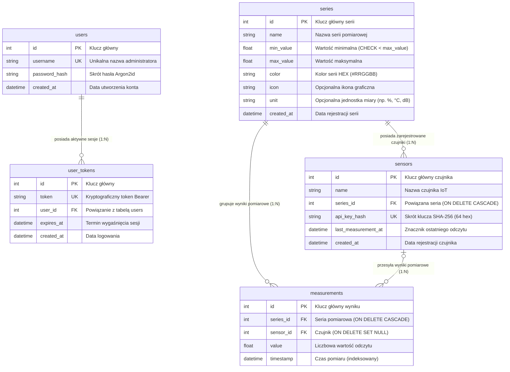

# 🏰 Waterdeep Watchtower – Diagram Związków Encji (ERD)

Niniejszy dokument opisuje strukturę relacyjnej bazy danych systemu **Waterdeep Watchtower**, spełniającej wymagania **T4** oraz **B4** specyfikacji projektu ZAI 26Z.

---

## 🗺️ Diagram ERD (Mermaid)

---

## 📋 Opis Tabel i Relacji

### 1. Tabela `users`
Przechowuje konta administratorów systemu.
* `id` – klucz główny (autonumeracja).
* `username` – unikalna nazwa użytkownika (indeksowana).
* `password_hash` – skrót hasła wygenerowany algorytmem **Argon2id** (T5).
* Relacja: **1:N** z tabelą `user_tokens` (usunięcie konta unieważnia wszystkie tokeny kaskadowo).

### 2. Tabela `user_tokens`
Zarządza sesjami administratora i tokenami Bearer.
* `token` – losowy token kryptograficzny (min. 48 bajtów losowych).
* `user_id` – klucz obcy wskazujący na tabelę `users` (`ON DELETE CASCADE`).
* `expires_at` – czas wygaśnięcia tokenu (domyślnie 24h).
* Po wylogowaniu (`POST /api/auth/logout`) token jest bezpowrotnie usuwany z bazy danych.

### 3. Tabela `series`
Definiuje serie pomiarowe monitorowane przez punkt dowodzenia Straży Miejskiej Waterdeep.
* `min_value` i `max_value` – dopuszczalne granice pomiarowe serii.
* Ograniczenie spójności: `CHECK (min_value < max_value)`.
* Relacje: **1:N** z tabelami `sensors` oraz `measurements`. Zgodnie z kontraktem API usunięcie serii (`DELETE /api/series/{id}`) kaskadowo usuwa wszystkie powiązane z nią czujniki oraz wyniki pomiarów.

### 4. Tabela `sensors`
Ewidencja autonomicznych czujników IoT rejestrujących telemetrię.
* `series_id` – klucz obcy wskazujący serię docelową (`ON DELETE CASCADE`).
* `api_key_hash` – **klucz API czujnika nigdy nie jest przechowywany w postaci jawnej** (wymóg T5). W bazie zapisywany jest wyłącznie skrót **SHA-256** (64 znaki).
* `last_measurement_at` – aktualizowany automatycznie przy każdym poprawnym odczycie.

### 5. Tabela `measurements`
Niezmienniczy (immutable) rejestr odczytów telemetrycznych.
* `series_id` – klucz obcy serii (`ON DELETE CASCADE`).
* `sensor_id` – klucz obcy czujnika (`ON DELETE SET NULL`). Wyrejestrowanie czujnika nie usuwa dotychczasowych danych – pole `sensor_id` przyjmuje wartość `NULL`, a pomiary pozostają w bazie.
* `timestamp` – czas rejestracji pomiaru (domknięte przedziały `from` i `to`).

---

## ⚡ Indeksy Wydajnościowe (Optymalizacja Zapytań Czasowych T4)

1. `ix_measurements_series_timestamp ON measurements(series_id, timestamp)` – kluczowy indeks złożony optymalizujący zapytania zakresowe `GET /api/measurements?series=...&from=...&to=...`.
2. `ix_measurements_timestamp ON measurements(timestamp)` – optymalizuje sortowanie i filtrowanie po osi czasu.
3. `ix_sensors_api_key_hash ON sensors(api_key_hash)` – natychmiastowe wyszukiwanie sensora przy autoryzacji nagłówka `X-API-Key`.
4. `ix_user_tokens_token ON user_tokens(token)` – szybka weryfikacja tokenu sesji Bearer.
